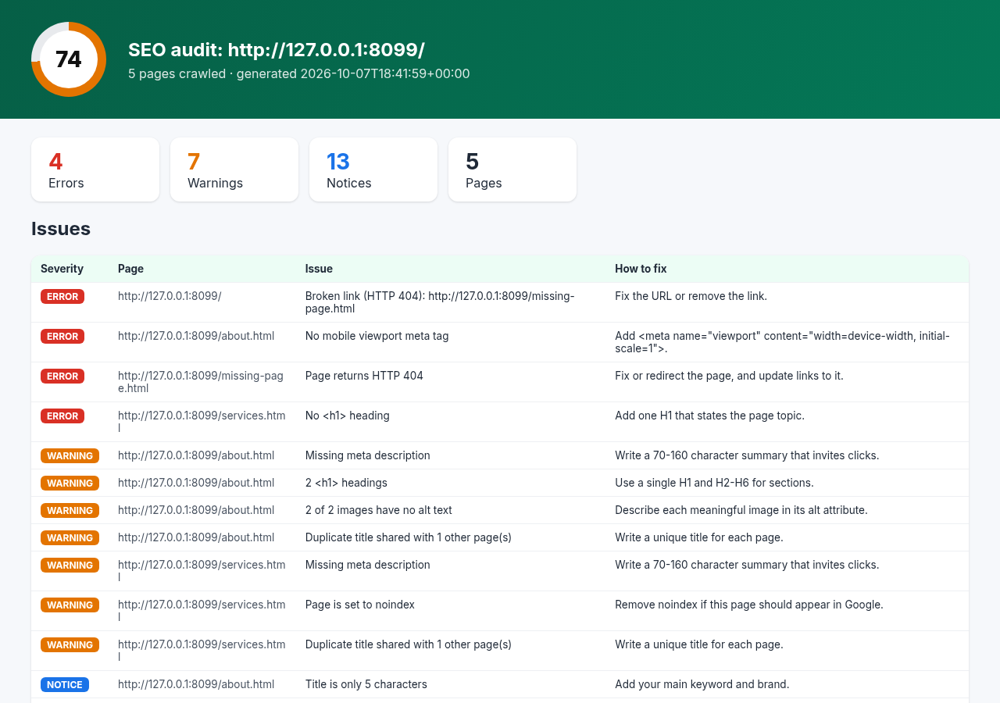

# SEO Site Audit Tool (Python)


A command-line SEO auditor that crawls a website and finds the on-page problems that hurt rankings: missing or duplicate **titles and meta descriptions**, **H1 and heading structure** problems, **broken links**, **images without alt text**, missing **canonical, viewport and Open Graph** tags, **noindex** pages, **thin content** and slow responses. It produces a scored **HTML report** you can hand to a client, plus JSON and CSV.



## Features

- **Same-domain crawler** (breadth-first) with `--max-pages`, a polite delay, `robots.txt` support and URL normalisation (fragments removed, duplicates skipped)
- **18 checks** per page and across the site:

| Severity | Checks |
| --- | --- |
| Error | Page returns 4xx/5xx, broken internal links, missing `<title>`, missing `<h1>`, missing mobile viewport |
| Warning | Title too long, missing meta description, multiple H1s, images without alt text, duplicate titles or descriptions across pages, `noindex`, slow server response |
| Notice | Short title or description, long description, skipped heading levels, no canonical, no `lang`, thin content (under 250 words), no Open Graph tags |

- **Broken link checker** that tries HEAD and falls back to GET, runs concurrently, and covers outbound links with `--check-external`
- **Scores from 0 to 100** for the whole site and for each page
- **Reports**: client-ready HTML, JSON for dashboards and CSV for spreadsheets
- **CI-friendly**: `--min-score 80` exits with code 1 when the score drops below 80
- 12 offline tests that crawl a fixture website served on `127.0.0.1`

## Tech stack

Python 3.10+, requests, BeautifulSoup 4 + lxml, pytest

## Install

```bash
git clone https://github.com/Josephobaje/seo-site-audit-tool-python.git
cd seo-site-audit-tool-python
python -m venv .venv && source .venv/bin/activate   # Windows: .venv\Scripts\activate
pip install -r requirements-dev.txt
```

## Usage

```bash
# Audit up to 50 pages and write an HTML report
python -m seoaudit https://your-site.com -o reports/audit.html

# Bigger crawl, check outbound links too, export everything
python -m seoaudit https://your-site.com --max-pages 200 --check-external \
    -o reports/audit.html -o reports/audit.json -o reports/issues.csv

# Use in CI: fail the build if the score is below 80
python -m seoaudit https://staging.your-site.com --min-score 80
```

```text
Crawled 5 pages. Score: 74/100
4 errors, 7 warnings, 13 notices
  [error  ] http://127.0.0.1:8099/  Broken link (HTTP 404): http://127.0.0.1:8099/missing-page.html
  [error  ] http://127.0.0.1:8099/about.html  No mobile viewport meta tag
  ...
```

See [`docs/sample-report.html`](docs/sample-report.html) and [`docs/sample-report.json`](docs/sample-report.json). They come from the demo site in `tests/site/`, which you can audit yourself:

```bash
python -m http.server 8099 --directory tests/site &
python -m seoaudit http://127.0.0.1:8099/ -o reports/demo.html
```

## Running tests

```bash
pytest
```

## Project structure

```text
seoaudit/
  parser.py    # extracts title, meta, headings, images, links and word count
  crawler.py   # same-domain BFS crawler, robots.txt, concurrent link checker
  checks.py    # SEO rules, duplicate detection and scoring
  audit.py     # runs crawl, checks and link checks together
  report.py    # HTML / JSON / CSV reports
  cli.py       # command-line interface
tests/site/    # small demo website with deliberate SEO mistakes
```

## Customising the rules

Thresholds such as title length, description length and thin-content word count are constants at the top of `seoaudit/checks.py`. Each rule is a few lines in `page_issues()`, so it is easy to add your own.

## Author

**Joseph Obaje**, Full Stack Developer (PHP, Python, Flutter) and Cybersecurity Specialist

- GitHub: [@Josephobaje](https://github.com/Josephobaje)
- LinkedIn: [joseph-obaje](https://www.linkedin.com/in/joseph-obaje)
- Email: [josephobaje264@gmail.com](mailto:josephobaje264@gmail.com)

## License

Released under the [MIT License](LICENSE). © 2026 Joseph Obaje
